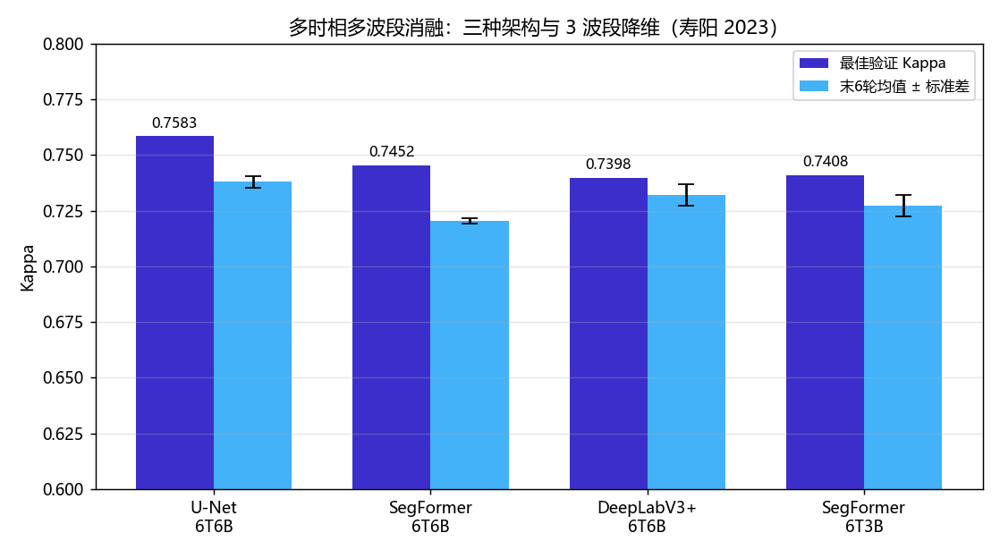
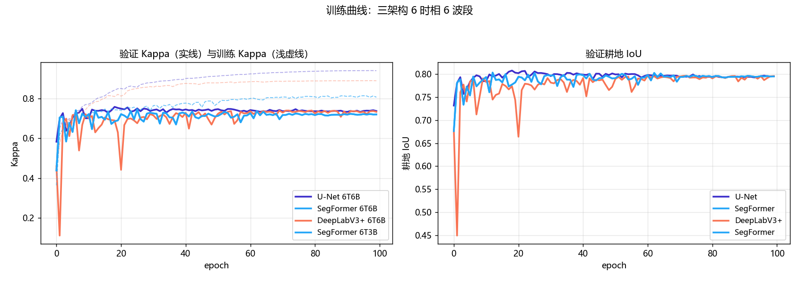

# 多时相 Sentinel-2 耕地分割（Multi-Temporal Cropland Segmentation）

基于 **6 时相 × 6 波段 Sentinel-2** 影像的耕地（cropland）二值语义分割方法，附完整的三架构对比与消融实验。目标区域为山西寿阳旱作区，标签为 30 m 土地利用产品。

- 任务：耕地 vs 非耕地 二值分割
- 输入：`(6 时相, 6 波段, H, W)`，波段 B2/B3/B4/B8/B11/B12
- 模型：U-Net、SegFormer、DeepLabV3+（统一训练协议）
- 关键设计：**空间分块划分**（train/val 不重叠，杜绝空间泄漏）





## 主要结果

**6 时相 × 6 波段，100 epoch 收敛后**（寿阳，空间分块验证集）：

| 模型 | 配置 | 最佳 Kappa | 末 6 轮 Kappa（均值 ± 标准差） | 耕地 IoU | OA |
|---|---|---|---|---|---|
| **U-Net** | 6T6B | **0.7583** | 0.7380 ± 0.0026 | 0.8078 | 0.8809 |
| SegFormer | 6T6B | 0.7452 | 0.7205 ± 0.0012 | 0.8026 | 0.8750 |
| DeepLabV3+ | 6T6B | 0.7398 | 0.7321 ± 0.0048 | 0.7952 | 0.8719 |
| SegFormer | 6T3B | 0.7408* | 0.7273 ± 0.0048 | 0.7980 | 0.8726 |

\* 6T3B 在第 33 轮被中断，取当轮最佳值；该曲线中断时仍在上升，因此 **0.7408 是下界而非收敛值**，不可与 100 轮结果直接比较。

完整表格见 [results/summary.csv](results/summary.csv)，原始训练历史见 [results/history/](results/history/)。

### 读数须知（重要）

1. **"最佳 Kappa"是 100 轮内的峰值，偏乐观**；训练在第 19–80 轮先后到达峰值后缓慢回落。请优先看"末 6 轮"列——它反映模型的真实收敛水平。
2. **单种子实验**。模型间差距（U-Net 0.758 vs DeepLabV3+ 0.740，Δ≈0.019）与各自末轮波动量级相当，**架构排序不具统计显著性**；不应据此宣称某架构显著优于另一架构。
3. 验证集为同一区域的空间分块划分，衡量的是**区域内部泛化**，不是跨区域泛化。

## 消融实验状态

| 消融 | 状态 | 说明 |
|---|---|---|
| 6T6B vs 6T3B（波段） | **部分完成** | 6T3B 中断于 33 轮；且该 3 波段为纯可见光，**不含近红外**，其解释需谨慎 |
| 6T6B vs 1T6B（时相） | **已作废** | 见下 |

### 1T6B 单时相实验为何被排除

原 1T6B 消融取时间轴第 0 期（4 月）作为单时相输入，但**该期影像在训练数据中约 72% 像元为零值（无数据填充）**。模型大部分输入是空白，所有 1T6B 运行均未正常收敛（Kappa 在 0.01–0.33 间震荡；DeepLabV3+ 的 history 文件损坏为空）。

**结论：本仓库不引用任何 1T6B 数字。** 如需时相消融，应先修复单期数据完整性，选择有代表性的单期（如 7 月）重跑。`results/summary.csv` 中相关行已标注 `EXCLUDED`。

## 方法要点

### 1. 空间分块划分，而非随机像素划分

遥感分割中随机划分会导致 train/val 相邻块空间重叠，指标虚高。本项目按空间块位置划分（`scripts/prepare_data.py::split_patches`），验证块与训练块不重叠。

### 2. 统一训练协议

三个架构共用同一配置骨架（`configs/base_config.json`）、同一数据、同一指标（`utils/metrics.py`）：Kappa、OA、mIoU、耕地类 F1/IoU。`models/factory.py` 统一构建模型并适配输出。

### 3. 异常处理与可复现

- 训练前强制校验 GPU（`scripts/assert_gpu.py`）
- 每轮 `history.json` 落盘，训练中断可恢复
- NaN 检测 + 梯度裁剪（DeepLabV3+ 早期训练曾出现数值不稳定）

## 项目结构

```
├── train.py                 # 训练主入口（数据集、训练循环、指标）
├── config.py                # 配置加载/合并
├── evaluate.py              # 独立评估脚本
├── models/
│   ├── factory.py           # 模型工厂（unet / segformer / deeplabv3plus）
│   └── output_adapter.py    # 输出层适配（5 类 -> 2 类二值）
├── utils/metrics.py         # Kappa / OA / mIoU / F1 / IoU
├── scripts/
│   ├── prepare_data.py      # 影像+标签 -> 训练集（含空间分块）
│   ├── run_ablation.py      # 批量消融
│   ├── predict_10m.py       # 10 m 分辨率推理
│   └── assert_gpu.py        # GPU 校验
├── configs/                 # 各实验配置（路径为相对路径）
└── results/
    ├── summary.csv          # 全部运行汇总（含已作废标记）
    ├── history/             # 各运行原始训练历史
    ├── kappa_comparison.png
    └── training_curves.png
```

## 快速开始

```bash
pip install -r requirements.txt

# 1. 准备数据：影像 (T,C,H,W).npy + 标签 (H,W).npy，按空间块划分 train/val
python scripts/prepare_data.py --image_dir <影像目录> --label_dir <标签目录> --output_dir data

# 2. 训练
python train.py --config configs/exp_shouyang_unet_6t6b.json

# 3. 评估
python evaluate.py --config configs/exp_shouyang_unet_6t6b.json
```

数据目录约定：

```
data/
└── Shouyang/
    ├── train/images/*.npy   # (6, 6, 256, 256) float32
    ├── train/labels/*.npy   # (256, 256) uint8，1=耕地
    ├── val/images/*.npy
    └── val/labels/*.npy
```

## 环境

- Python ≥ 3.10
- PyTorch ≥ 2.0（CUDA 12.1），训练在 NVIDIA CMP 40HX 上进行
- rasterio、albumentations 等见 `requirements.txt`

## 已知限制（诚实版）

1. **单种子**：所有运行 seed=42 一次，无误差棒；架构间小差距（<0.03）不可作为结论。
2. **1T6B 消融作废**：单期输入含 ~72% 零值，详见上文。
3. **6T3B 未收敛**：33 轮中断；且 3 波段为纯可见光（不含 NIR），其"波段消融"的物理解释受限。
4. **标签为 30 m 产品**：验证指标衡量"与 30 m 标签的一致性"，不代表 10 m 精细边界质量。
5. **同区域验证**：仅空间分块，未做跨年份/跨区域泛化测试。

## 数据来源

- **影像**：Sentinel-2 L2A 地表反射率，6 时相（2023 年 4/5/6/7/9/10 月），波段 B2/B3/B4/B8/B11/B12。Copernicus / ESA 开放数据，遵守 [Copernicus 数据使用政策](https://www.esa.int/Applications/Observing_the_Earth/Copernicus)。
- **标签**：**CLCD（China Land Cover Dataset，中国年度土地覆盖数据集）** 30 m 分辨率，由武汉大学黄昕、李家艺团队基于 335,709 景 Landsat 影像在 Google Earth Engine 上制作；本文从中提取耕地类别作为二值标签。CLCD 总体精度 79.31%（Yang & Huang, 2021）。获取方式见 [CLCD 官方页面](https://irsip.whu.edu.cn/resv2/CLCD.php)。

> 注意：CLCD 标签为 30 m 分辨率。本仓库的验证指标衡量模型输出与 CLCD 标签的一致性，不等同于 10 m 精细边界质量（详见"已知限制"）。

## 引用

若本仓库对你的研究有帮助，请引用本软件与 CLCD 数据集：

```bibtex
@software{multi_temporal_cropland_seg,
  title  = {Multi-Temporal Sentinel-2 Cropland Segmentation},
  author = {mengzhuoer},
  year   = {2026},
  url    = {https://github.com/mengzhuoer/multi-temporal-cropland-seg}
}

@article{yang2021clcd,
  title   = {The 30 m annual land cover dataset and its dynamics in China from 1990 to 2019},
  author  = {Yang, Jie and Huang, Xin},
  journal = {Earth System Science Data},
  volume  = {13},
  pages   = {3907--3925},
  year    = {2021},
  doi     = {10.5194/essd-13-3907-2021}
}
```

## 许可

MIT License，见 [LICENSE](LICENSE)。代码中的模型结构基于 PyTorch 官方实现与 timm（SegFormer），各自遵循其原始许可。Sentinel-2 与 CLCD 数据不在本仓库分发，请从各自官方渠道获取。
